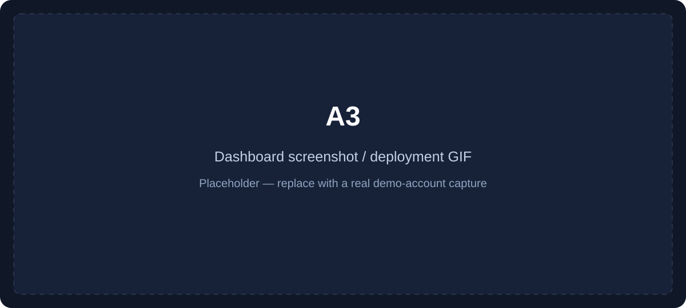
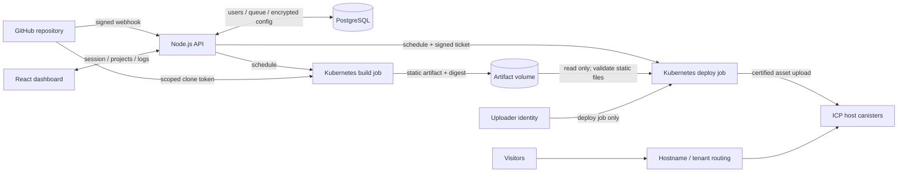

# A3

**Push to GitHub. Build in Kubernetes. Publish a static frontend to the Internet Computer.**

[](https://github.com/BorisStoyanv/A3/actions/workflows/ci.yml)
[](LICENSE)


A3 is a Git-connected hosting platform built as a diploma project. It combines a React dashboard, a Node.js control plane, isolated build and deploy jobs, and a Rust canister that serves certified static assets. The control plane was deployed on Google Kubernetes Engine and subsequently Amazon EKS; the published manifests share a Kubernetes deployment model, with an EKS provisioning example.

**Pilot snapshot: 34 users · 38 projects · 283 deployment records.** These are historical database totals from the June 12, 2026 snapshot, not monthly active users, paying customers, or a claim that every deployment succeeded. No customer records or database dumps are included here.

## See it

> **Live demo:** pending — add a verified public URL here.
>
> **Screenshot / GIF:** pending — replace the placeholder below with a dashboard capture using a demo account.



## What it does

1. Sign in with GitHub and authorize an installation of the A3 GitHub App.
2. Select a repository and branch. Set the root directory, build command, output directory, and optional build-time environment variables.
3. Push a commit. A verified GitHub webhook queues a deployment; a Kubernetes job clones and builds the project.
4. A separate job imports only the validated static output, regenerates trusted deployment configuration, and uploads it to an ICP host canister.
5. Follow progress and logs in the dashboard and open the deployed site's URL.

The primary hosting mode shares a canister across sites under tenant asset prefixes. A routing layer connects a site's hostname to its assigned canister and tenant path. This reduces the need to create and fund a canister for every small site, while introducing shared capacity, operator custody, and isolation responsibilities.

A3 hosts **static output**: HTML, CSS, JavaScript, images, and browser applications. A statically exported framework app can work; a framework app that requires a server cannot run its server here. There is no customer Node.js server, SSR runtime, serverless function runtime, or hosted customer database. Browser applications can call independently hosted APIs.

## Why ICP

ICP uses a **reverse-gas model**: canisters pay for their resource consumption, so visitors do not need a wallet or tokens to load a website. Static query execution currently has no cycle fee. That makes ICP an interesting static asset origin, particularly for applications already using the network.

It does **not** make the service free to operate. Storage, asset uploads and other updates, canister funding, Kubernetes workers, PostgreSQL, DNS, and any external edge service still have costs. Query pricing and resource limits can change; see the [official cycle-cost reference](https://docs.internetcomputer.org/references/cycle-costs/). This project does not establish that A3 is cheaper overall than Vercel or another incumbent.

## Architecture



The control plane and workers run on a chosen Kubernetes cloud. GKE and EKS represent deployment history and deployment options, rather than simultaneous active-active failover. ICP is the website asset origin; the dashboard, account database, build queue, and build compute remain conventional infrastructure.

## Features

- GitHub App sign-in, repository selection, branch-triggered builds, and repository-scoped clone credentials.
- Persistent deployment queue, concurrency limits, deployment stages, logs, and notifications.
- Configurable build roots, commands, and static output paths; plain HTML repositories can skip a build.
- Encrypted environment-variable storage with local AES-GCM or Google Cloud KMS; variables are supplied only to build subprocesses.
- Separate build and deploy jobs, with no build access to the uploader identity or Kubernetes service-account token.
- Tenant-aware Rust asset canister with signed deployment tickets, expiry, replay protection, and tenant-bound upload checks.
- Dashboard for projects, deployments, usage summaries, and administrator host-canister management.
- Optional GitLab integration and Stripe billing code. These require separate configuration and are not evidence of production revenue.

Canister ownership hand-off (“Eject”) is incomplete and disabled by default. It is a roadmap item, not a current portability guarantee.

## Stack and decisions

| Component      | Technology                                                          | Reason and trade-off                                                                                                                                 |
| -------------- | ------------------------------------------------------------------- | ---------------------------------------------------------------------------------------------------------------------------------------------------- |
| Dashboard      | React 18, Vite 8, Recharts                                          | A browser dashboard with a separate analytics bundle. The UI is static; the control API is separate.                                                 |
| API            | Node.js 24, Express 4, PostgreSQL 16                                | Simple HTTP orchestration and durable relational state. Database-backed queues avoid another broker, but need careful concurrency handling.          |
| Workers        | Kubernetes Jobs, Docker, `dfx`                                      | Per-deployment resource limits and separate credentials. More operational work than a managed build service; containers still share the host kernel. |
| Asset origin   | Rust, ICP CDK, certified-assets library                             | Reuses certified asset serving and adds tenant authorization. The upstream SDK source is pinned to a specific commit.                                |
| Authorization  | GitHub App, server-side sessions, Argon2                            | Installation access is checked using the logged-in user's GitHub authorization before tokens are minted.                                             |
| Secrets        | AES-GCM / optional Google Cloud KMS                                 | Protects stored customer variables; the master key and deploy identity still require operator custody.                                               |
| Infrastructure | Portable Kubernetes manifests, EKS example, GKE deployment history  | Exercises cloud operations without changing the ICP target. Cloud networking, storage, ingress, and IAM require provider-specific configuration.     |
| Quality        | Node test runner, ESLint, Prettier, Rustfmt, Clippy, GitHub Actions | Keeps security regression checks and builds repeatable without live credentials.                                                                     |

## Run locally

Requirements: Node.js 24 with npm, PostgreSQL 16, and Git. Rust and `dfx` are needed for canister work; Docker, Kubernetes, and a network-policy-capable cluster are needed to exercise the deployment pipeline.

```sh
nvm use
npm ci
npm run check
```

The tests use synthetic inputs, a temporary local Git repository, and a fake `dfx` executable. They do not need cloud credentials or a live canister.

To run the API and dashboard:

```sh
cp .env.example backend/.env
# Edit backend/.env: set DATABASE_URL and ENV_VARS_MASTER_KEY.
# Generate a master key with: openssl rand -base64 32
npm run dev:api
# In a second terminal:
npm run dev:ui
```

The API starts on port 3000 and applies the ordered SQL migrations automatically. Vite serves the dashboard on port 5173 and proxies API requests. Create the PostgreSQL database before starting the API.

A real sign-in requires your own GitHub App configuration. Direct account registration is disabled; leaving GitHub unset permits source/UI inspection, not a complete authenticated deployment demo. To receive webhooks locally, use an HTTPS development endpoint and configure the App callbacks accordingly. See [deployment and GitHub setup](docs/deployment.md).

## Environment and deployment

[`.env.example`](.env.example) lists the required configuration and optional GitLab/Stripe settings, with placeholders only. Never put cloud keys, uploader identities, or deploy-ticket signing keys in a project's customer build variables. Frontend build variables are public once bundled into a website.

Build the API/runner and dashboard images from the repository root:

```sh
docker build --platform linux/amd64 -t a3-backend:local .
docker build --platform linux/amd64 -f frontend/Dockerfile -t a3-dashboard:local .
kubectl kustomize infra/k8s/platform/mainnet
```

These commands build images and render manifests; they do not deploy cloud resources. Follow the [deployment guide](docs/deployment.md) to configure a host canister, signing keys, Kubernetes Secrets, images, storage, networking, and routing. The examples deliberately use placeholder domains and require operator configuration.

## Security work and validation

The public preparation addressed three concrete issues: customer environment variables reaching credential-bearing deployment processes, GitHub installation IDs being trusted without checking the current user's access, and malformed inputs or asynchronous failures escaping API error handling. Regression tests cover all three, including actual build subprocess environments, malicious artifact configuration, and requests through the application's registered routes.

`npm run check` runs lint, formatting, tests, and the dashboard build. CI also runs Rust formatting, Clippy, and a release Wasm build. The Rust library currently has no unit tests; passing its build is not a canister authorization or upgrade integration test. See [security boundaries and verification limits](docs/security.md).

The publication source and the four original repository histories were scanned with Gitleaks before publication. No operational A3 secret was confirmed in those histories; local recovery credentials, database backups, and private configuration were excluded from this repository. This is a preparation check, not a guarantee against future disclosure.

## Lessons learned

**A useful infrastructure project needs a narrower product case.** The ICP developer market is small, and many general-purpose frontend projects can already use a free incumbent tier. A familiar Git workflow alone is a weak reason to switch. A3's clearest audience is developers who specifically want ICP-hosted static assets; operating Kubernetes creates a fixed cost that low query costs do not erase.

**Shared canisters trade efficiency for responsibility.** Sharing reduces per-site provisioning, but sites compete for storage and operational attention. Tenant prefixes and signed tickets constrain writes; they do not give each customer their own canister controller or independent failure domain. A compromised operator or uploader remains significant.

**Builds are untrusted execution.** Separating jobs is necessary, and importing a build's `dfx.json` would defeat that separation. The deploy job now copies validated static bytes into a fresh directory and creates its own configuration. Live network-policy enforcement and stronger sandboxing remain important operational work.

**I would simplify the first version.** Start with a single cloud, explicit static-site support, a smaller control-plane module, a cost model, and security tests before adding billing and provider breadth. Measure retained users, deployment success, and operator cost rather than relying on cumulative account or deployment totals.

## Roadmap

- Complete **Eject**: provision a dedicated canister, transfer controller ownership, and verify who funds and operates it afterward.
- Add a clear retention policy and **cleanup of idle sites**, with owner notification and recovery expectations.
- Add live canister authorization/upgrade tests and cluster tests for metadata access and network-policy enforcement.
- Improve worker sandboxing, artifact provenance, operational metrics, and measured cost per active site.

## License

[MIT](LICENSE). Upstream dependencies retain their own licenses; see [third-party notices](THIRD_PARTY_NOTICES.md).
