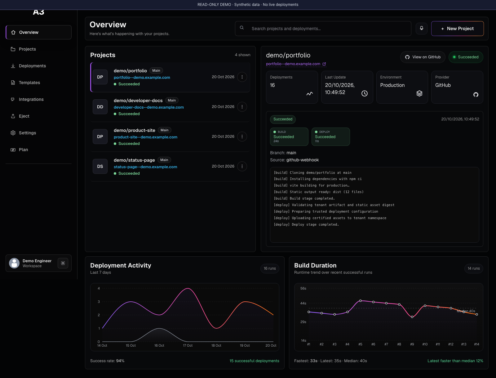
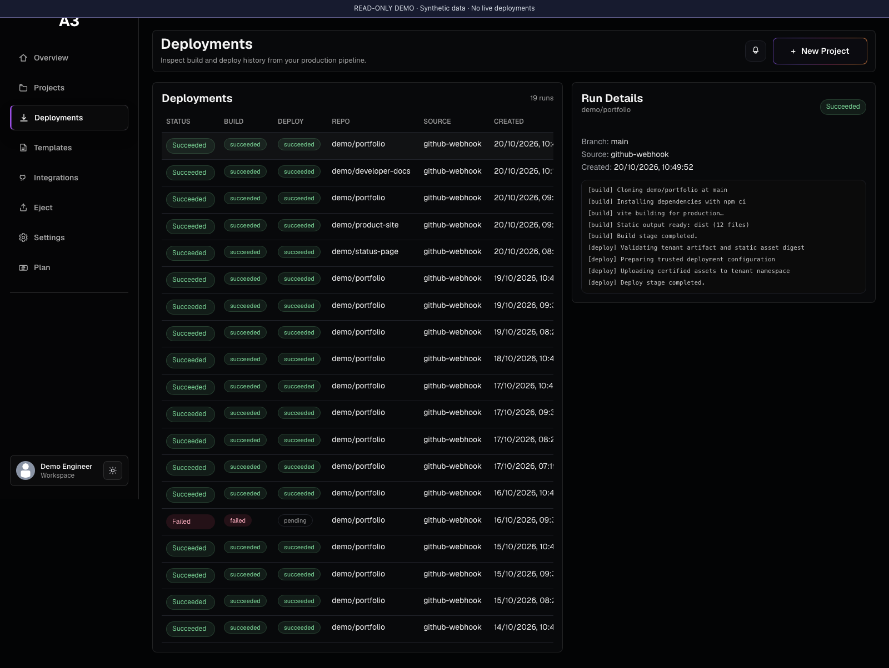
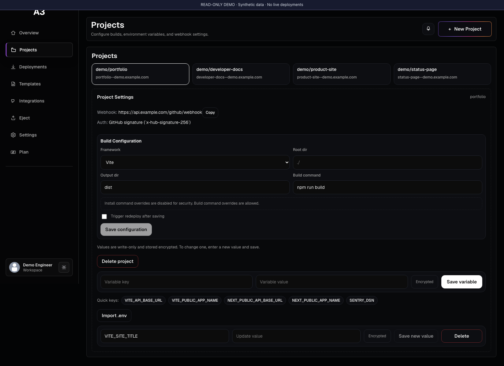
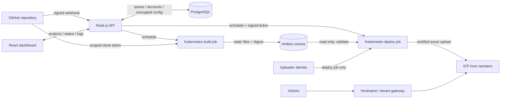

# A3 — Git-to-ICP Deployment Automation

**A Git-connected platform that builds static frontends in Kubernetes and deploys them to Internet Computer canisters.**

[](https://github.com/BorisStoyanv/A3/actions/workflows/ci.yml)
[](LICENSE)


Built as a diploma project, A3 brings the familiar **push → build → deploy** workflow to ICP static hosting. It spans a React dashboard, a Node.js API, a persistent PostgreSQL deployment queue, Kubernetes workers, and a Rust asset canister. The control plane was deployed on **Google Kubernetes Engine** and subsequently **Amazon EKS**.

**Pilot snapshot:** 34 users · 38 projects · 283 deployment records, as of June 12, 2026. These are historical database totals; deployment records include attempts, and user totals do not establish active or paying users.

[Try the local demo](#try-the-dashboard) · [Architecture](#architecture) · [Code tour](#explore-the-code) · [Deployment guide](docs/deployment.md)



_Actual application UI, captured locally with synthetic demo data. Sample URLs, logs, durations, and success rates illustrate the interface; they are separate from the historical pilot totals above._

## Engineering highlights

- **Build/deploy isolation:** separate Kubernetes jobs, distinct service accounts, no uploader identity in the build pod, and no customer environment variables in the deploy job. Deployment imports validated static files and regenerates trusted `dfx` configuration instead of executing build-supplied hooks.
- **GitHub authorization:** App installations are checked against the logged-in user's GitHub access before repository-scoped clone tokens are minted. A supplied installation ID is not treated as proof of access.
- **Durable orchestration:** a PostgreSQL queue tracks deployment stages, concurrency, logs, notifications, and host assignment across API restarts.
- **Tenant-aware canister:** Rust wraps certified asset serving with tenant namespaces and signed deployment tickets, including expiry and replay protection.
- **Cloud operations:** Docker images, Kubernetes RBAC, storage and network policies, an EKS provisioning example, and deployment experience on GKE and EKS.
- **Repeatable checks:** security regression tests exercise actual API routes and subprocess environments; GitHub Actions runs lint, formatting, tests, frontend builds, and Rust checks.

## Try the dashboard

Requires **Node.js 24** and npm. No database, GitHub App, wallet, or cloud credentials are needed for this preview.

```sh
git clone https://github.com/BorisStoyanv/A3.git
cd A3
npm ci
npm run demo
```

Open **http://127.0.0.1:4173**. Explore the overview, deployment history, project configuration, and theme toggle. The preview serves the real frontend with a read-only fixture API; it does not build repositories or deploy sites. All write requests are rejected. See [demo details and screenshot provenance](docs/demo.md).

<details>
<summary><strong>More screenshots — deployment inspection and project configuration</strong></summary>

### Deployment history and logs

Inspect individual runs, separate build/deploy outcomes, and stage logs.



### Project configuration

Configure the build root, command, output directory, and encrypted build-variable entries.



All screenshots use the same synthetic, read-only demo. They are browser captures of the existing React components.

</details>

## What it does

1. Sign in with GitHub and authorize the A3 GitHub App for a repository.
2. Select a branch and configure the build root, command, output directory, and optional build-time variables.
3. Push a commit. A signed webhook queues a deployment, and a Kubernetes build job produces static output.
4. A separate deploy job validates the artifact and uploads assets to an ICP host canister.
5. Inspect progress in the dashboard and open the deployed site's URL through the configured hosting gateway.

The primary mode shares a host canister across sites under tenant asset prefixes. Sharing reduces per-site provisioning, but introduces shared capacity, operator custody, and tenant-isolation responsibilities.

**Supported workload:** static HTML/CSS/JavaScript, browser applications, and statically exported framework sites. Customer SSR servers, serverless functions, and databases are outside the hosting runtime. Applications can call independently hosted APIs. Optional GitLab and Stripe integrations exist in the code and require separate configuration.

## Architecture



Kubernetes hosts the control plane and build compute; ICP serves website assets. GKE and EKS are deployment history and options, not an active-active failover system. Production requires an operator-configured tenant gateway; a standalone edge-router implementation is not bundled here.

## Stack and decisions

| Layer                     | Choice                                                                        | Reason and trade-off                                                                                                                                   |
| ------------------------- | ----------------------------------------------------------------------------- | ------------------------------------------------------------------------------------------------------------------------------------------------------ |
| Dashboard                 | React 18, Vite 8, Recharts                                                    | Static UI with a separate analytics bundle and a conventional control API.                                                                             |
| Control plane             | Node.js 24, Express 4, PostgreSQL 16                                          | Relational account/project state and a durable queue without an additional broker; concurrency remains an application concern.                         |
| Workers                   | Docker, Kubernetes Jobs, `dfx`                                                | Resource limits and separate credential boundaries; more operational overhead than managed build infrastructure. Containers still share a host kernel. |
| Asset origin              | Rust, ICP CDK, certified-assets library                                       | Reuses certified asset serving, adding tenant authorization and deployment tickets. The upstream SDK dependency is pinned to a commit.                 |
| Authorization and secrets | GitHub App, server-side sessions, Argon2, AES-GCM / optional Google Cloud KMS | User-scoped repository access and encrypted stored variables; operators still control encryption keys and deploy identities.                           |
| Infrastructure and CI     | Kubernetes, EKS example, GitHub Actions                                       | Portable workloads with provider-specific networking/storage/IAM and automated verification.                                                           |

## Why ICP

ICP's **reverse-gas model** means canisters pay for their resource consumption; website visitors do not need wallets or tokens. Static query execution currently has no cycle fee, making ICP an interesting asset origin for applications already using the network. See the [official cycle-cost reference](https://docs.internetcomputer.org/references/cycle-costs/).

Storage, uploads and other updates, canister funding, Kubernetes, PostgreSQL, DNS, and any external edge service still cost money. This project does not establish an overall cost advantage over Vercel or another incumbent.

## Explore the code

| Area                                              | Entry point                                                                                                                            |
| ------------------------------------------------- | -------------------------------------------------------------------------------------------------------------------------------------- |
| API, queue, job scheduling                        | [`backend/src/server.js`](backend/src/server.js)                                                                                       |
| Installation authorization and request validation | [`backend/src/security/`](backend/src/security/)                                                                                       |
| Build/deploy pipeline and trusted artifact import | [`scripts/deploy-runner-staged.js`](scripts/deploy-runner-staged.js), [`scripts/security-artifact.cjs`](scripts/security-artifact.cjs) |
| Tenant authorization and certified asset serving  | [`canister/src/lib.rs`](canister/src/lib.rs)                                                                                           |
| React dashboard and charts                        | [`frontend/src/`](frontend/src/)                                                                                                       |
| Kubernetes RBAC, storage and network policy       | [`infra/`](infra/)                                                                                                                     |
| Security regression tests                         | [`backend/test/`](backend/test/)                                                                                                       |

## Run and verify

```sh
npm run check  # ESLint, Prettier, tests, frontend build
```

The 17 security tests cover malformed requests across registered API routes, GitHub installation access decisions, actual build subprocess environments, and malicious artifact imports. A staged-flow test builds a temporary Git repository and uses a fake `dfx`; it does not deploy to ICP. CI additionally runs Rustfmt, Clippy, and release Wasm compilation. Rust currently has no unit tests; live canister authorization and upgrade tests remain a gap.

For the real control plane, create a **PostgreSQL 16** database, then:

```sh
cp .env.example backend/.env
# Fill DATABASE_URL, ENV_VARS_MASTER_KEY and your GitHub App configuration.
# Generate the master key with: openssl rand -base64 32
npm run dev:api  # port 3000; applies the ordered SQL migrations
# In a second terminal:
npm run dev:ui   # port 5173; proxies the API
```

Direct account registration is disabled; authenticated use requires your own GitHub App. Customer deployment execution additionally needs Kubernetes and a configured host canister. The [deployment guide](docs/deployment.md) covers image builds, GitHub callbacks, canister setup, Secrets, storage, ingress, and tenant routing. [`.env.example`](.env.example) contains placeholders only.

The public preparation fixed environment leakage into deploy processes, unchecked GitHub installation IDs, and API input/error handling. Source and original histories were scanned with Gitleaks, and private recovery material was excluded. See [security boundaries and verification limits](docs/security.md). Local and CI checks do not prove network-policy enforcement or a live cloud rollout of the hardened version.

## Lessons learned

**Product focus matters.** The ICP market is small, and many frontend projects can already use a free incumbent tier. A familiar Git workflow alone is a weak switching incentive. A3's clearest audience is developers specifically seeking ICP-hosted assets; low query costs do not erase Kubernetes' fixed costs.

**Shared canisters need explicit trade-offs.** Tenant checks and signed tickets constrain writes, but customers still share capacity and an operator-controlled failure domain. Sharing does not provide independent canister ownership.

**Untrusted builds need boundaries from the start.** Separate jobs are insufficient if the deploy step trusts generated configuration. Reconstructing configuration from validated static output is part of the security boundary. Stronger worker sandboxing and live isolation tests would be priorities in a next iteration.

**I would simplify the first version.** Start with one cloud, a smaller control-plane module, explicit static-site support, security tests, and a measured cost model before billing or provider breadth. Track retention, deployment success, and cost per active site alongside cumulative pilot totals.

## Roadmap

- **Eject:** complete dedicated-canister provisioning and verified controller ownership hand-off. Currently incomplete and disabled by default.
- **Idle-site cleanup:** define retention, owner notification, and recovery behavior.
- Add live canister authorization/upgrade tests and cluster tests for metadata denial and network-policy enforcement.
- Improve sandboxing, artifact provenance, operational metrics, and measured cost per active site.

## License

[MIT](LICENSE). Dependencies retain their own licenses; see [third-party notices](THIRD_PARTY_NOTICES.md).
